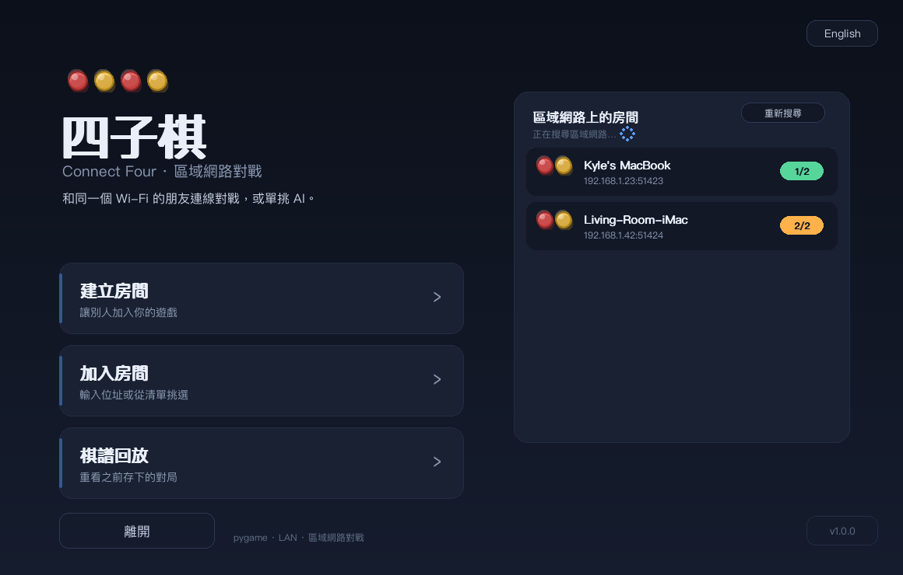
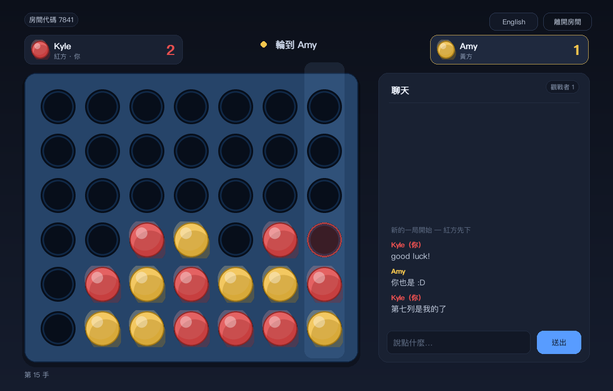
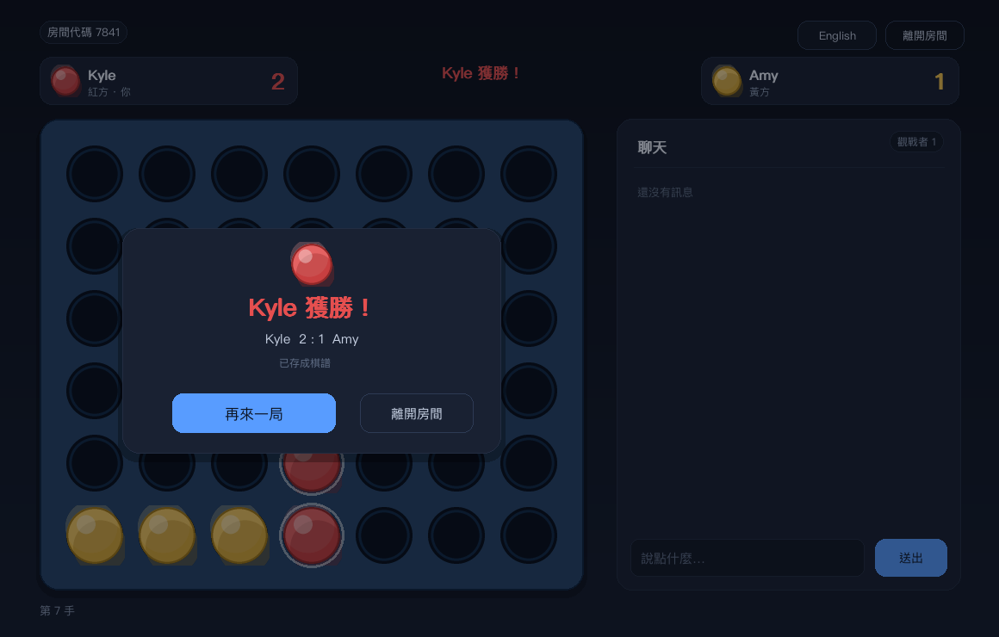
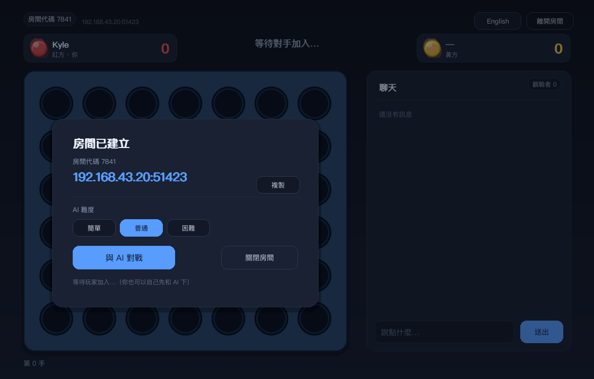
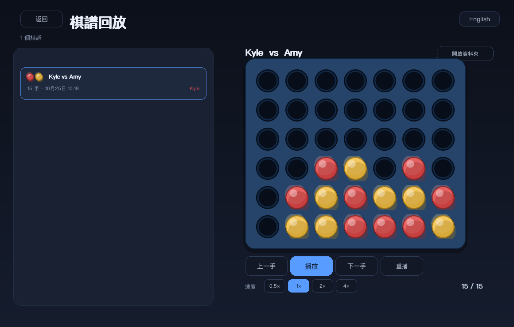

# Connect Four · 四子棋 LAN

Four in a row for two people on the **same Wi-Fi** — or against a three-level
AI. Python 3.10+ and pygame. Standard library for everything else.



## Features

- **LAN play** — host a room and share the address; the other player finds it
  automatically over UDP broadcast, or types the IP by hand. No accounts, no
  server, no internet.
- **Authoritative host** — the host runs the rules engine and broadcasts full
  snapshots, so the client cannot cheat or drift out of sync.
- **Bilingual UI** — Traditional Chinese / English, switchable live with the
  chip in the top-right corner and remembered between runs.
- **Spectator mode** — a third person (or more) can join and watch; the room
  shows a spectator count.
- **Chat** — talking while you play, with system lines for new games, results,
  AI changes and disconnects.
- **AI opponent** — easy / normal / hard (bitboard alpha–beta, hard tier ~1.6 s
  at depth 8). Play offline, or use it to fill the second seat while you wait.
- **Scoreboard + rematch** — scores survive rematches; both players vote for the
  next game. The host can start against the AI in one click.
- **Replays** — every finished game is saved on each machine and can be replayed
  disc by disc, with play/pause, step, `0.5×–4×` speed and an "open folder"
  button.
- **Polished pygame UI** — animated disc drops, column hover preview, win pulse,
  letterboxed design that scales to any window or Retina display.

| Game | Finished game |
| --- | --- |
|  |  |

| Lobby | Replays |
| --- | --- |
|  |  |

English UI: [menu](docs/screenshots/01-menu-en.png) · [game](docs/screenshots/03-game-en.png)

## Quick start

```bash
cd games-python/connect-four
python3 -m pip install pygame       # the only dependency
python3 connect_four.py             # menu: host, join, replays
```

1. **Host**: pick *Host a Room* → the card shows the room code and the LAN
   address (`192.168.x.y:port`). Send that to your friend, or just start against
   the AI.
2. **Joiner** (same Wi-Fi): pick *Join a Room* → your host appears in the room
   list; otherwise type its address.
3. Red (the host seat) moves first. Click a column; the disc drops in.

Command-line shortcuts:

```bash
python3 connect_four.py --host                 # open a room immediately
python3 connect_four.py --host --ai hard       # room, with the AI in the other seat
python3 connect_four.py --host --port 51423    # fixed TCP port (open it in the firewall)
python3 connect_four.py --join 192.168.1.23    # find the port with discovery
python3 connect_four.py --join 192.168.1.23:51423
python3 connect_four.py --lang en --name Amy
python3 connect_four.py --shots docs/screenshots   # re-render these screenshots
python3 connect_four.py --selftest             # run the unit tests
```

Join a game by hand when discovery is blocked: *Join a Room* → type
`192.168.1.23` and the port shown on the host's lobby card.

## Rules and controls

- 7 columns × 6 rows; drop a disc, it falls to the lowest free cell.
- Four in a row horizontally, vertically or diagonally wins; a full board is a
  draw. Red moves first.
- Click a column to drop. Hovering shows the landing spot as a ring.
- Chat field: click, type, <kbd>Enter</kbd> to send, <kbd>Esc</kbd> to leave it.
- <kbd>Esc</kbd> anywhere → leave/confirm dialog; the language chip switches
  between 中文 and English on every screen.
- Replay screen: <kbd>Space</kbd> play/pause, <kbd>←</kbd>/<kbd>→</kbd> step.

## AI levels

| Level | Looks ahead | Feel |
| --- | --- | --- |
| Easy | 2 ply + 35 % random | beginner friendly |
| Normal | 4 ply, 0.35 s budget | punishes obvious mistakes |
| Hard | 8 ply iterative deepening, 1.6 s budget | blocks and builds threats |

The AI is a bitboard `alpha–beta` search with a transposition table and centre
`MOVE_ORDER = (3, 2, 4, 1, 5, 0, 6)`. It never guesses: on easy it occasionally
picks a random legal column, above that it always searches.

## Where things live

| File | Role |
| --- | --- |
| `connect_four.py` | CLI entry point (`--host`, `--join`, `--shots`, `--selftest`) |
| `engine.py` | pure rules: board, moves, win detection, records, replay frames |
| `ai.py` | bitboard AI with three difficulty levels |
| `net_server.py` | authoritative host: seats, syncs, chat, rematch, records, UDP discovery |
| `net_client.py` | thin TCP JSON-lines client + discovery helper |
| `ui.py` | all pygame screens, widgets usage, animations, headless `--shots` |
| `theme.py` | palette, CJK font loading, discs, buttons, text fields, toasts |
| `i18n.py` | zh/en strings, `error_text()` mapping for server error codes |
| `records.py` | replay files, list/summary/frames, "open folder" |
| `settings.py` | JSON prefs (language, name, AI level, records folder) |
| `tests/` | 44 unit/integration tests (engine, AI, records, protocol, UI) |

Replays are written to `records/` next to the code by default — override it on
the host machine in settings (`~/.connect_four_settings.json`, key
`records_dir`). The host and every client each keep their own copy.

## Network details (for tinkerers)

- **TCP**: newline-delimited JSON, one object per line, default port *any free*
  (shown on the lobby card). The host is authoritative.
- **Handshake**: client `{"t":"hello","name","role","ver"}` → server
  `{"t":"welcome","id","seat","role","room",...}`; then `{"t":"sync",...}` after
  every change (full board, seats, scores, chat, rematch votes, record, `you`).
- **Intents**: `move{col}`, `chat{text}`, `rematch`, `ai{level}` (host seat
  only), `leave`, `ping`.
- **Errors** come back as `{"t":"error","code","msg"}` with codes such as
  `not_your_turn`, `spectator`, `bad_column`, `column_full`.
- **Discovery**: UDP broadcast probe `{"t":"connect4.discover","ver":1}` on port
  **54322**; hosts answer `{"t":"connect4.room","code","port","host","players",
  "phase"}`. Broadcast is best-effort — manual IP entry always works.

## Tests

```bash
python3 connect_four.py --selftest
# or, individually:
python3 tests/test_engine.py     # rules, win lines, AI, record storage
python3 tests/test_net.py        # server/client protocol over loopback + UDP discovery
python3 tests/test_ui.py         # every screen renders headless; a match is won by clicking
```

The UI tests run on the SDL dummy video driver, so they work over SSH and in CI.

## Troubleshooting

- **The friend cannot see the room.** Allow incoming connections for `python3`
  in *System Settings → Network → Firewall*, and make sure both devices are on
  the same subnet (guest Wi-Fi often isolates clients). Type the IP manually if
  broadcast discovery is blocked.
- **"Connection failed".** The host may be on a different port: read the exact
  `192.168.x.y:port` from the host's lobby card.
- **No sound / no window in a remote shell.** That is headless — use
  `--shots DIR` or `--selftest`.
- **Chinese text renders as boxes.** The theme looks for PingFang, Hiragino,
  STHeiti, Songti, Arial Unicode and Noto CJK in that order; install one of them
  on Linux.
- **Reset preferences.** Delete `~/.connect_four_settings.json`.
